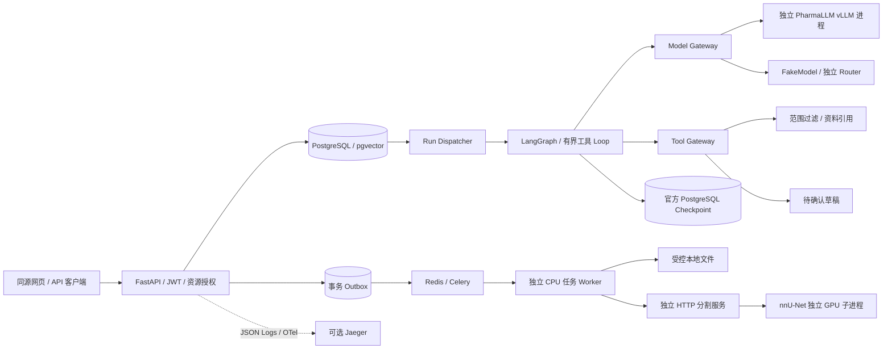

# 架构与实现边界

代码位于 `agent_app/src/pharma_agent/`，API 不导入 Torch、Transformers 或 vLLM。

2026-10-25 增量：支持账户级 Full access / Ask for approval、可读团队代号，以及管理员/医生/审核员和科室结果复核，详见 [流程、权限与迁移](hospital_access.md)。模式由请求与账户策略固定，经权限校验后进入工具；模型输出不能自行提升授权。复核只读共享不改变原文件所有权。

## 身份和模型输出

JWT 中只放签名主体与租户，角色和用户/租户有效状态从数据库重新读取。注册总是新建租户，公共注册不能通过已知 tenant ID 加入他人团队。同一团队的其他用户也看不到彼此的会话、偏好、任务和文件；团队资料是该团队成员共享的资源。

Graph State 只保存窗口消息、路由决策、工具观察、引用和回答。`Actor`、运行上下文和服务对象通过 LangGraph `context_schema/Runtime` 传入，模型不能修改真实身份。工具输入禁止未知字段，包括伪造的 `user_id/tenant_id`。

普通 SFT 通过 Prompt 选择受限动作，本地 vLLM 模型配置启用 `structured_output` 后，由适配器在路由请求中发送 `response_format=json_schema`，由服务端约束输出格式；自然语言回答不发送该参数。该配置描述服务端的约束解码能力，不代表模型经过 Tool Calling 训练。其他服务需确认支持后再启用，默认独立 Router 保持普通文本兼容模式。

先校验动作和工具白名单，再校验工具参数；长度截断的路由也视为无效。默认失败后携带校验错误码重试一次，仍失败则澄清；重试不回填未校验正文。日志保留响应 hash、校验错误码、结束原因与 Token 数，不记录正文。参数不通过时不执行工具。后续切换 Router 只需配置模型别名。

本地 PharmaLLM 的 `stop_token_ids` 显式包含当前 Qwen tokenizer 的 `<|endoftext|>` / `<|im_end|>`，补齐导出配置与 ChatML 的结束标记差异。回答专用 `answer_repetition_penalty` 只应用于 `purpose=answer`，不影响 JSON 路由；这些 vLLM 扩展只有模型配置明确声明时才发送，并随 Run 的模型快照保存。无检索资料时 Prompt 明确禁止生成编号引用及书目；这仍是模型行为约束，不等于引文真实性验证。

## 运行和恢复

创建 Run、用户消息、会话占用和初始事件在同一事务中完成；数据库部分唯一索引防止同一会话有多个 `queued/running/cancelling` Run。创建请求支持幂等键及内容冲突检测。

每个执行中的 Graph 使用一条独立 psycopg 连接，这条连接持有 thread 对应的 PostgreSQL advisory lock，并供该次 `AsyncPostgresSaver` 写入。取消/连接关闭会释放锁；旧租约失效后新进程也不会与旧连接交叉写同一 thread。Run 的心跳和租约用于检测中断，不做写操作自动回放。新请求从授权业务消息重建窗口并重置上轮工具状态。

取消运行先进入 `cancelling`，会话继续占用；执行进程停止后再写终态并释放会话。SSE 只是持久事件的消费者，关闭浏览器不取消 Run。数据库事实、Checkpoint 与 SSE 各有职责，终态消息与 completed/error 事件在业务事务中提交。

草稿获得执行授权与 Outbox 同事务持久化，Dispatcher 有限重试 Redis 发布。分割在 Ask for approval 下由用户逐次确认，在 Full access 下由后端按该轮授权自动提交；工程演示仍需确认。重复消息只允许一个有效 Worker 领取，claim token 防止旧执行者覆盖新结果。数据库任务表是状态来源。现有 CPU Mock 演示及独立 HTTP T1 分割服务两类任务。

## 可扩展点与限制

- `models.py`：`ChatModelAdapter`、`GenerationRequest/Result`、角色映射；不同类型的确定性 CV 推理应走独立服务 Tool。
- `tools.py`：实现适配器、声明 Schema/权限/版本，再注册配置。新增工具同时扩展 `RouteDecision` 白名单，这是有意保留的审核边界。
- `retrieval.py`：替换 Embedding 服务；当前 pgvector 精确搜索，未实现 ANN/Reranker/PDF/OCR。
- `jobs.py` / `segmentation.py`：长任务独立执行；T1 分割已固定权重、输入协议、坐标保留和结果资产契约，同会话可读取有效测量追问。
- 当前不含 SSO、MCP、MinIO、自动语义记忆、自动摘要、生产 SLA 或临床合规声明。短期上下文用有界窗口，偏好是有限枚举；已有 T1 分割仍需独立质量与临床用途验收。

参考：[LangGraph Checkpointers](https://docs.langchain.com/oss/python/langgraph/checkpointers)、[pgvector Python](https://github.com/pgvector/pgvector-python)、[vLLM 并行部署](https://docs.vllm.ai/en/stable/serving/parallelism_scaling/)。
