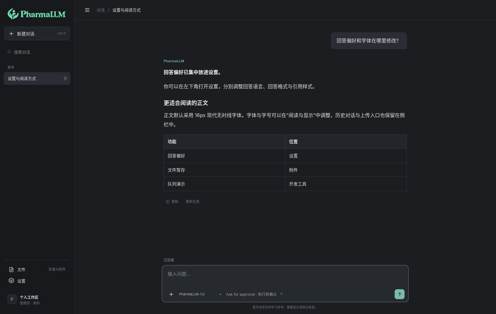
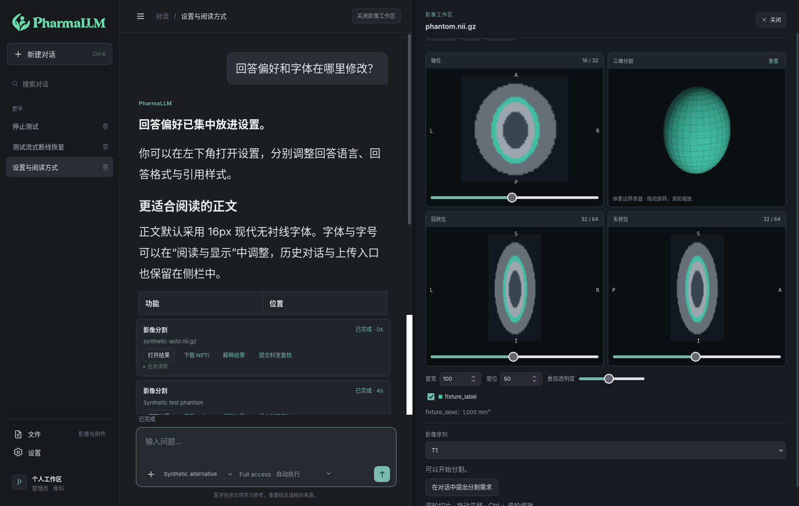

<picture>
  <source media="(prefers-color-scheme: dark)" srcset="PharmaLLM_V1.1/agent_app/src/pharma_agent/web/logo-dark.svg">
  
</picture>

# PharmaLLM-Agent

中文医学问答与 MRI 分割工作台，覆盖大语言模型微调、评测、Agent 工具编排、异步影像分割及结果复核。

本项目由 [PharmaLLM](https://github.com/xxPcy/PharmaLLM) 衍生而来。原仓库侧重医学语言模型的数据处理、微调、评测与 vLLM 服务，本仓库在此基础上增加 Agent 对话、影像分割工作台和科室复核流程。为方便复现，保留相关训练与评测代码；产品界面继续使用 PharmaLLM 品牌。

用户可以上传影像，通过自然语言发起股骨头与髋臼分割，在四视图工作区查看结果，并继续询问任务状态和分割体积。语言模型与分割模型在独立 GPU 进程中运行，应用 API 和任务 Worker 保持独立。

**在线体验：域名接入中，当前尚未提供公网体验地址。** 本仓库发布代码、配置示例与技术文档；模型权重、训练数据和用户文件由部署者单独管理。

[本地启动](docs/LOCAL_DEPLOYMENT.md) · [系统与实验说明](docs/PROJECT_OVERVIEW.md) · [GitHub 上传指南](docs/GITHUB_UPLOAD.md) · [本地 GPU 公网访问方案](docs/PUBLIC_ACCESS.md) · [与原项目的关系](docs/RELATED_PROJECTS.md)

## 系统功能

- **医学对话**：流式回答、历史会话、有限窗口上下文、可选择对话模型；同会话可追问已完成分割的体积。
- **Agent 编排**：LangGraph 状态图，先验证工具参数和权限，再创建任务；工具轮次和图步数有上限。
- **影像工作台**：NIfTI / DICOM 解析，轴位、冠状位、矢状位和三维分割结果，窗宽窗位、标签叠加、结果下载。
- **自然语言分割**：单通道 T1 MRI 的股骨头与髋臼分割；Ask for approval 逐次确认，Full access 对已授权的分割请求自动执行。
- **团队协作**：可读团队代号、科室、管理员/医生/审核员；医生提交结果后，审核员在授权范围内复核。
- **工程保障**：租户与用户授权、幂等、事务 Outbox、任务租约、SSE 重连、审计与私有文件访问。

## 页面预览

以下截图来自隔离的浏览器测试环境。影像为合成体模、回答和任务为测试数据，用于展示界面；**不代表真实患者病例、分割精度或临床验证**。





## 技术栈

| 层次 | 实现 |
| --- | --- |
| 训练与评测 | Qwen3-8B-Base、PyTorch、Transformers、PEFT、DeepSpeed ZeRO-3；全参数 SFT / LoRA 对照 |
| 语言模型服务 | 独立 vLLM、OpenAI 兼容 HTTP 接口、结构化路由约束 |
| Agent | LangGraph、Pydantic 工具契约、PostgreSQL Checkpointer |
| API 与界面 | FastAPI、Uvicorn、原生 HTML / CSS / JavaScript、SSE、Canvas |
| 持久化与检索 | PostgreSQL、SQLAlchemy、Alembic、pgvector；默认 hash Embedding 仅作工程演示 |
| 长任务 | Redis、Celery、事务 Outbox、领取租约与幂等状态更新 |
| 影像与分割 | NumPy、SciPy、NiBabel、pydicom、独立 nnU-Net 服务、常驻模型进程 |
| 权限与观测 | JWT、Argon2、追加式审计、JSON 日志、OpenTelemetry / 可选 Jaeger |
| 验证与部署 | pytest、Node 前端测试、合成数据浏览器检查、Docker Compose 基础设施、独立 Python 环境 |

## 历史模型评测

下面为 2026-09-24 的离线医学选择题评测：固定数据划分，温度 0，最多生成 8 个新 Token，只输出选项字母。

| 模型 | CMB-Exam（280 题） | MedQA-ZH（3426 题） |
| --- | ---: | ---: |
| Qwen3-8B-Base | 35.71% | 21.89% |
| PharmaLLM 全参数 SFT | 58.93% | 81.52% |
| 官方 Qwen3-8B 对照 | 67.14% | 84.71% |

本项目 SFT 优于原始预训练底座，在该次评测中仍低于官方后训练模型。以上结果不等同于网页开放问答准确率，不能作为临床效果声明。设置与统计见[原始汇总文档](PharmaLLM_V1.0/docs/results/model_evaluation_comparison_qwen3_8b.md)；原始数据、逐题预测和模型权重未随代码发布。

## 快速开始

从仓库根目录执行。需要 Linux、Python 3.11–3.13（建议 3.12）及 Docker Compose：

```bash
cd PharmaLLM_V1.1/agent_app
python3 scripts/init_env.py --mode fake
bash scripts/install.sh
source .venv/bin/activate
docker compose up -d --wait db redis
bash scripts/migrate.sh
python -m pharma_agent.cli seed-demo
python scripts/start_api.py
```

浏览器访问 `http://127.0.0.1:8082`。`fake` 为确定性的 CPU 工程演示，不提供真实医学模型能力，也不产生真实分割。使用你自己的模型需按[完整启动说明](docs/LOCAL_DEPLOYMENT.md)配置独立 vLLM 和 nnU-Net 环境。

## 目录

```text
PharmaLLM_V1.0/                 数据处理、训练、评测、推理脚本及配置
PharmaLLM_V1.1/agent_app/       Agent、API、界面、迁移、测试、基础设施 Compose
PharmaLLM_V1.1/docs/agent/      架构、数据模型、权限、任务与运维文档
PharmaLLM_V1.1/model/           分割模型结构元数据；不含权重
docs/                          公共启动、项目说明、上传及公网访问指南
tools/check_public_repo.py     文件范围、大文件及常见凭据检查
RELEASE_MANIFEST.json          本次整理文件的 SHA-256 清单
```

## 实现边界

这是工程与研究展示项目。普通 SFT 模型通过受约束 JSON 和应用校验选择工具，未声称经过原生 Tool Calling 训练。上下文为有界窗口和同会话业务事实，未实现无限记忆。默认检索为 hash 基线，未部署医学语义检索或自动 PDF/OCR 入库。股骨头/髋臼标签不区分左右，未公布独立分割精度或临床验证结论。AWQ 脚本仍为待补齐入口，不能视作可复现的量化流程。

代码沿用 [MIT 许可证](LICENSE)。依赖、预训练模型、训练数据与分割权重分别遵守其各自许可，见[第三方说明](THIRD_PARTY_NOTICES.md)。
