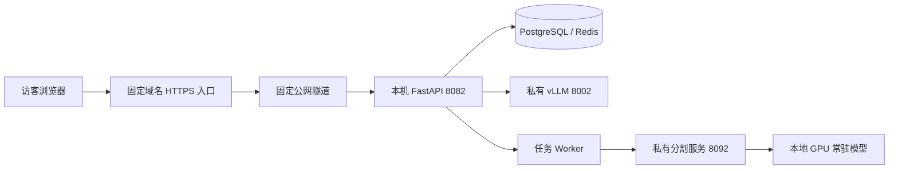

# 固定域名访问本地 GPU 服务

目标：保留现有服务器上的模型、API、Worker、数据库和影像存储，通过固定 HTTPS 地址提供求职展示。购买域名本身不包含服务器或推理资源。

## 建议的域名结构

- `demo.example.com`：应用体验入口，代理到 `http://127.0.0.1:8082`。
- GitHub 仓库：源代码、文档、评测设置和截图。
- 可选项目介绍页：提供视频、架构和体验入口，在 GPU 服务维护时仍能查看项目。

`example.com` 仅为示例，配置时使用你实际持有的域名。现阶段仓库未配置任何真实公网域名、隧道令牌或访客账号。

## 固定 Cloudflare Tunnel 路径

1. 准备自己的域名和 Cloudflare 账号，将域名按官方要求接入 DNS。
2. 在原服务器安装 `cloudflared`，建立固定 Tunnel 并配置后台服务。
3. 添加 published application route：公网主机名指向本机应用根地址 `http://127.0.0.1:8082`。
4. 使用浏览器和手机移动网络实测连接、登录、SSE 逐字输出、上传和结果更新。

服务器需要能与隧道服务建立出站连接。隧道凭据只保存在服务器私有配置中，不提交 Git。

**不使用临时 Quick Tunnel。** 它不支持本应用依赖的 SSE。固定 Tunnel 也要验证流式响应未被缓存，保留 `Content-Type: text/event-stream`、Authorization 与 Last-Event-ID；新建会话、登录及用户私有 API 不应被公共缓存。

## 公开展示前的准备

- 将 API、语言模型、Worker 和分割管理进程交由 systemd 等进程管理器托管，配置重启与日志；不能依赖临时终端一直开着。
- 建立独立展示团队及非管理员使用账号，使用合成或明确获准公开的样例。
- 建好展示账号后按需要关闭公开注册：私有配置设置 `ALLOW_REGISTRATION=false` 并重启 API。不要把管理员密码写进公开 README。
- 真实模型配置稳定后启用 `APP_ENV=production`，保持故障注入关闭。生产模式禁止 FakeModel；这不是一键实现所有生产保障的开关。
- 按实际硬件降低并发和请求额度。现有按分钟限流不能代替完整的访客 GPU 预算、滥用控制或每日消费上限。
- 仅公开应用入口，不公开 PostgreSQL、Redis、vLLM、分割或观测端口。
- 测试备份与恢复，明确展示数据清理策略；模型服务离线时提供可理解的提示及视频备用入口。

服务器或推理服务停止后，公网隧道无法替代它继续运行模型。国内访客的访问速度取决于具体网络，购买域名不会改善服务器出口；应以实测为准。

参考：[固定 Tunnel 配置](https://developers.cloudflare.com/tunnel/get-started/)、[Quick Tunnel 限制](https://developers.cloudflare.com/tunnel/get-started/quick-tunnels/)。
